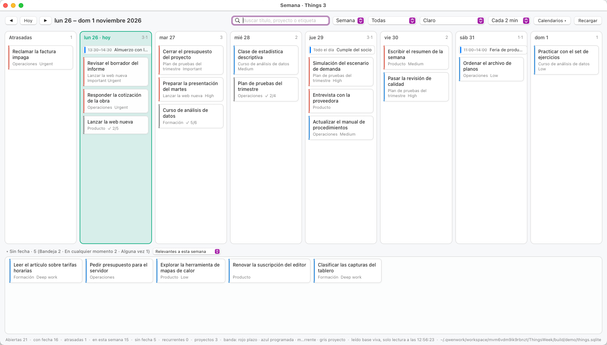
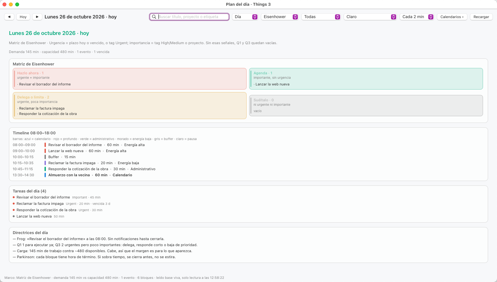

# Semana · Things 3 + calendario, en vista semanal y plan de día

App nativa para macOS (AppKit, sin Storyboard ni proyecto de Xcode) con dos vistas sobre
la misma ventana:

- **Semana**: tablero de lunes a domingo con las tareas abiertas de Things 3, una columna
  de atrasadas, los eventos del calendario en su día y una bandeja de tareas sin fecha.
- **Día**: plan del día elegido, calculado con el marco metodológico que selecciones
  (Eisenhower, time blocking por energía, Eat the Frog, MoSCoW, 1-3-5 o Pareto Top-3).

Escrita para un MacBook Air 2017 con macOS 13: binario Intel, sin dependencias externas,
una sola librería del sistema (`libsqlite3`) y unos 4 MB de RAM en reposo. Interfaz bilingüe
español/inglés (menú **Vista ▸ Idioma**), con el idioma del sistema como valor inicial.

**Solo lectura.** La app no escribe en Things ni en el calendario: lee sus bases SQLite.

| Vista semanal | Plan del día (Eisenhower) |
|---|---|
|  |  |

Las dos capturas son del **modo demo**, con tareas y eventos inventados:

```bash
./build.sh                              # compila build/Semana.app
zsh Tools/demo.sh                       # genera las bases de ejemplo y abre la app
zsh Tools/demo.sh --day                 # lo mismo, en la vista del día
```

El modo demo apunta la app a `build/demo/` mediante `SEMANA_THINGS_DB` y `SEMANA_CALENDAR_DB`,
así que funciona sin Things 3 instalado y sin darle permisos a nada.

## Contenidos

- [Cómo lee Things](#cómo-lee-things-y-por-qué-así)
- [Cómo lee el calendario de Apple](#cómo-lee-el-calendario-de-apple)
- [El plan del día](#el-plan-del-día)
- [Construir](#construir) · [Permisos](#permisos-evitar-re-pedir-acceso-total-al-disco-en-cada-build) · [Uso](#uso)
- [Limitaciones honestas](#limitaciones-honestas) · [Estructura](#estructura) · [El icono](#el-icono)
- [Cinco trampas de AppKit](#cinco-trampas-de-appkit-que-costaron-la-ventana)

Licencia MIT.

## Cómo lee Things (y por qué así)

Things 3 **no expone una API de lectura**. Su esquema de URL (`things:///…`) solo sirve
para crear, abrir, completar o cancelar. Por eso la app lee la base SQLite de Things,
**siempre sin escribir en ella**, con dos rutas en este orden:

1. **Base viva en modo solo lectura** (`SQLITE_OPEN_READONLY`). SQLite atiende la
   lectura por MVCC desde el WAL: no bloquea a Things ni toca el archivo. Es la misma
   vía que usa el MCP de Things que ya tienes instalado, y evita copiar 31 MB en cada
   refresco.
2. **Espejo temporal**, si lo anterior falla: copia `main.sqlite` + `-wal` + `-shm` a
   `$TMPDIR/ThingsWeek.read`, valida con `PRAGMA quick_check`, y trabaja sobre la copia
   (abierta en lectura-escritura *solo para que SQLite pueda rehacer su índice WAL*).
   La copia se borra al terminar.

La barra de estado dice en cada momento qué ruta se usó.

Acciones: **Abrir en Things** y **Completar** salen por el esquema de URL oficial.
Nada en la app modifica tu biblioteca directamente.

### El formato de fechas (no es un epoch)

Los enteros `startDate`, `deadline` y `rt1_nextInstanceStartDate` de Things no son
segundos ni días desde una fecha base: son **bits empaquetados**

```
YYYYYYYYYYYMMMMDDDDD0000000        año << 16 | mes << 12 | día << 7
```

Cualquier intento de tratarlos como epoch deriva: el paso vale 128 por día *dentro* del
mismo mes y salta al cambiar de mes, así que un ajuste lineal acumula 1, 2 o incluso
138 días de error según el rango. La app decodifica con las máscaras
`134152192 / 61440 / 3968` (año, mes, día), el mismo esquema que usa `things-py`, y el
resultado se verificó contra fechas reales mostradas por Things.

Reglas de lectura usadas:

| Campo | Significado |
|---|---|
| `type` | 0 = tarea, 1 = proyecto, 2 = encabezado (los encabezados no se listan) |
| `status` | 0 = abierta (2 canceladas y 3 completadas quedan fuera) |
| `trashed` | 1 excluye la fila |
| `start` | 0 Bandeja · 1 En cualquier momento · 2 Alguna vez |
| `rt1_recurrenceRule IS NOT NULL` | tarea recurrente |
| `rt1_nextInstanceStartDate` | próxima ocurrencia; en recurrentes manda sobre `startDate`, que guarda el ancla original |
| `rt1_instanceCreationPaused` | 1 = en pausa, Things no la muestra, la app tampoco |

**Día en que cae una tarjeta:** `deadline` si existe; si no, `startDate`. Las tareas con
ambas se muestran una vez, en el día del plazo, con banda roja.

## Cómo lee el calendario de Apple

La base viva es `~/Library/Calendars/Calendar.sqlitedb` (no `Calendar Cache`, ni la tabla
`ZCALENDARITEM` que mencionan prompts antiguos: eso es Core Data de otra versión). Las
tablas que importan:

| Tabla | Para qué |
|---|---|
| `Calendar` | lista de calendarios: `ROWID`, `title`, `color`, `store_id` |
| `Store` | la **cuenta** dueña de cada calendario: iCloud, Google, "Other" (local), "Subscribed Calendars", "Default" |
| `CalendarItem` | el evento: `summary`, `start_date`, `end_date`, `all_day`, `hidden`, `status` |
| `OccurrenceCache` | una fila por día ocupado: `day`, `occurrence_date`, `calendar_id`, `event_id` |

Detalles que cuestan descubrirlos:

- **`day` y `occurrence_date` son `CFAbsoluteTime`**, no epoch Unix: segundos desde 2001,
  así que hay que sumar `978307200` para convertirlos.
- `OccurrenceCache.day` es la medianoche local del día, y `occurrence_date` el arranque
  real de esa ocurrencia. Los recurrentes ya vienen expandidos ahí, por eso se consulta
  esa tabla y no `CalendarItem` directamente.
- `CalendarItem.end_date - start_date` da la duración; en eventos de día completo
  `all_day = 1` y no se pinta hora.
- Se excluyen `hidden = 1` y `status = 2` (cancelados).
- **Calendarios apagados por defecto**: los marcadores internos (`DEFAULT_*`) y los que
  contienen *Found in Mail*, *Found in Natural Language*, *Facebook Birthdays*,
  *Phases of the Moon*, *Siri* o *Birthdays* en el título. Siguen apareciendo en el selector
  **Calendarios ▾** por si los quieres activar; los `DEFAULT_*` directos no se ofrecen porque
  nunca traen eventos tuyos.
- La selección se guarda **por título**, no por `ROWID`: en iCloud/Google los rowids pueden
  reordenarse entre sincronizaciones y el título es lo estable.
- Cada línea del selector **Calendarios ▾** trae la cuenta detrás: `Trabajo · Google`,
  `Personal · iCloud`, `Facebook Birthdays · En este Mac`, `Feriados · Suscritos`.
  Se saca de `Store.name` (un `LEFT JOIN` por `Calendar.store_id`) y se traduce al pintar el
  menú, no al leer la base: cambiar de idioma no obliga a recargar calendarios. Las cuentas
  guardadas con el correo en vez de con la marca se normalizan por dominio (gmail.com →
  Google, icloud.com/me.com → iCloud, outlook/hotmail/live → Outlook) para no mostrar
  direcciones completas en la interfaz.

Se lee en solo lectura, igual que Things, y necesita Acceso Total al Disco.

## El plan del día

`Planner.swift` es un motor puro: recibe tareas + eventos del día y devuelve un `DayPlan`.
La vista solo pinta. Los seis marcos disponibles:

| Marco | Qué decide | Con qué señal |
|---|---|---|
| Matriz de Eisenhower | 4 cuadrantes | urgencia = tag Urgent, plazo vencido o de mañana, o fecha programada pasada; importancia = tag Important o High |
| Time blocking por energía | bloques 08:00–18:00 | tamaño estimado + hora (profundo antes que administrativo) |
| Eat the Frog + 2 min + Parkinson | la rana, las victorias rápidas, hora de término | importancia + estimación ≥ 45 min |
| MoSCoW | Must / Should / Could / Won't | capacidad libre del día: Must ~55 %, Should ~85 %, Won't el desborde |
| 1-3-5 | 1 grande, 3 medianas, 5 chicas | ≥ 60 / ≥ 25 / < 25 min |
| Pareto · Top 3 | las 3 que mueven el día | orden de prioridad del marco activo |

**Escalera de prioridad.** La lista «Tareas del día» no sigue el orden de los cuadrantes:
ordena por etiqueta, de más a menos, y dentro del mismo escalón decide la urgencia real
(tag `Urgent`, plazo vencido o que cae mañana, o fecha programada ya pasada), después el
atraso y al final lo más corto primero:

```
Important › Urgent › High › Medium › Low › sin etiqueta
```

Cada fila repite en gris la etiqueta que la colocó ahí (`Important · 45 min`), para que el
criterio se pueda leer sin abrir Things; si no trae etiqueta y es urgente solo por calendario,
lo dice (`30 min · urgente por calendario`). El punto de color de la izquierda usa la misma
escalera: rojo, ámbar, azul y gris. Son tus etiquetas de Things tal cual, sin traducirlas.

**Colores en la matriz.** Los cuatro cuadrantes van teñidos y con barra de acento, para
distinguirlos sin leer: rojo *Hazlo ahora*, verde *Agenda*, ámbar *Delega o limita*, gris
*Suéltalo*. En tema oscuro cambia la intensidad del tinte, no el color.

**Esfuerzo estimado** (no hay campo de duración en Things): si el título o la nota dicen
"25 min" o "1h30", se usa eso; si no, `nº de ítems de checklist × 10`; si no, 90 min para
proyectos, 45 para tag High, 15 para Low, 30 por defecto. Es una estimación, no un dato.

**Capacidad**: 600 min de jornada (08:00–18:00) menos lo que ya ocupan tus eventos menos
60 min de pausas. La barra de estado muestra demanda vs capacidad, y el timeline deja de
asignar cuando se acaba la jornada: si algo queda fuera, aparece como tal en vez de
aplastarse contra las 18:00.

Los eventos del calendario mandan sobre las tareas en el timeline: un bloque nunca pisa una
cita, y las pausas largas solo se ponen si el hueco de las 13:00 está libre.

## Construir

```bash
cd ThingsWeek
./build.sh                      # produce build/Semana.app (firma ad-hoc)
open build/Semana.app
```

Opciones del build:

```bash
SIGN_ID="Semana Dev" ./build.sh                 # firma con identidad estable
INSTALL_DIR=/Applications ./build.sh            # instala en ruta fija (sin sudo si eres admin)
```

## Permisos: evitar re-pedir Acceso Total al Disco en cada build

La base vive en un *Group Container*, y macOS solo deja leerlo a apps con el
entitlement de ese grupo o con **Acceso Total al Disco** (Full Disk Access, FDA). No hay
un permiso más angosto posible para esta ruta.

FDA se recuerda por **bundle ID + hash de firma + ubicación del .app**. Con firma ad-hoc
(`-s -`) el hash cambia en cada compilación y por eso el permiso se cae. Para que quede
fijo:

1. **Crear una identidad de firma propia** (una sola vez):
   Acceso a Llaveros → menú *Acceso a Llaveros ▸ Asistente del certificado…* →
   *Crear un certificado…* → Nombre: `Semana Dev` · Tipo de certificado:
   **Code Signing** · Equipo: ningún certificado → Crear.
2. **Compilar siempre con esa identidad y en la misma ruta**:
   ```bash
   SIGN_ID="Semana Dev" INSTALL_DIR=/Applications ./build.sh
   ```
3. **Grantear FDA una vez** a `/Applications/Semana.app`:
   Ajustes del Sistema → Privacidad y seguridad → Acceso Total al Disco → `+` → arrastra
   la app → cierra y vuelve a abrir la app.

Si alguna vez TCC se porta mal tras un cambio de identidad, reinicia su registro:

```bash
tccutil reset SystemPolicyAllFiles cl.zamorano.semana
```

## Uso

| Atajo | Acción |
|---|---|
| `⌘←` / `⌘→` | semana anterior / siguiente (en vista Semana) |
| `⌘T` | volver a esta semana / hoy |
| `⌘R` | recargar ahora |
| clic en tarjeta o fila | abrir la tarea en Things |
| clic derecho | abrir · completar · copiar título · copiar UUID |

- **Selector `Semana / Día`** en la barra superior. En modo Día aparecen además el
  **selector de marco** y el stepper `◀ Hoy ▶` para moverte día a día; la fecha se recuerda.
- **`Calendarios ▾`**: menú con checkboxes por calendario, más *Todos*, *Solo los míos* y
  *Ninguno*. Al cambiar la selección se recarga al instante y queda guardada.
- **Idioma**: menú **Vista ▸ Idioma** → *Sistema / Español / English*. Cambia todo al vuelo
  (barra, menú, tablero, plan del día, menús contextuales y avisos) sin reiniciar, y se
  recuerda. `Sistema` sigue el idioma de macOS; los nombres de tus etiquetas de Things
  (`High`, `Urgent`, …) y los de tus proyectos no se traducen: son datos tuyos.
- **Hoy marcado**: en la vista semanal la columna del día de hoy lleva fondo teñido, borde
  de color y la cabecera `dom 25 · hoy`; en el plan del día el título añade `· hoy` y se
  pinta con el color de acento.
- **Bandeja «Sin fecha»**: rejilla de varias filas al pie de la ventana (aprovecha el alto,
  no una sola línea con scroll horizontal). El desplegable **Alcance ▾** decide qué muestra:
  *Relevantes a esta semana* (los proyectos/áreas que ya tienen algo con fecha en la semana
  visible, más lo que esté en la Bandeja), *Bandeja y cualquier momento*, o *Todas sin fecha*.
  Se pliega con `▾ Sin fecha`.
- **Auto-refresco** apagable (30 s, 2, 5, 15 min). Compara la fecha de modificación de la
  base y se salta el trabajo si no cambió, para no gastar batería de más.
- **Tema automático** por hora: oscuro de 19:00 a 06:59, con override manual.
- **Buscador** sobre título, proyecto, área, etiquetas y notas. El filtro se aplica también
  al plan del día: lo que no pase el filtro no entra en la matriz ni en el timeline.
- **Filtros**: todas, solo con fecha, solo plazos, solo proyectos.
- **`Abrir al iniciar sesión`** en el menú de la app (usa `SMAppService`, macOS 13+).
- Se recuerdan vista, día, marco, semana, filtro, búsqueda, calendarios activos, tema,
  idioma, alcance de la bandeja, intervalo de refresco, bandeja plegada y tamaño de ventana.
- La barra de estado dice en cada modo lo que importa: en Semana, totales y qué ruta de
  lectura se usó; en Día, el marco activo, demanda vs capacidad, eventos, nº de bloques y
  hora de la última lectura.

## Limitaciones honestas

- **El tema no siempre persiste**: elegir *Oscuro* puede volver a *Claro* al relanzar. El
  idioma sí se guarda, así que la sospecha está en `applyThemeMode` y en cómo el
  `NSPopUpButton` reenvía su acción cuando se le selecciona un índice por código. Sin arreglar.
- **Refresco**: las tareas *sin fecha* no envejecen solas en la base. Things calcula
  "Hoy" al abrirse; si no abres Things, una tarea programada para ayer seguirá apareciendo
  en su día y no en atrasadas hasta que Things vuelva a escribir. La app no simula ese
  motor.
- **Recurrencias**: se lee la próxima ocurrencia que Things ya calculó
  (`rt1_nextInstanceStartDate`); la app no corre su propio motor de recurrencia, así que
  una recurrente muy antigua sin instancia próxima puede no aparecer.
- **Plazos de proyecto**: los proyectos con plazo se muestran como tarjetas marcadas, pero
  Things propaga el plazo del proyecto a sus tareas en algunos casos: puede ver la misma
  fecha en dos tarjetas distintas.
- **Solo lectura**: completar desde la app delega en Things por URL, así que necesita que
  Things esté instalado (no hace falta que esté en primer plano).
- **Firma**: sin Developer ID, Gatekeeper exige clic derecho → Abrir la primera vez, y TCC
  recuerda la app por su firma.
- **Estimación de esfuerzo**: los minutos del plan son deducidos (título/nota → checklist →
  etiquetas → 30 por defecto). Sirven para repartir el día, no para comprometerse con ellos.
- **Eisenhower y tus etiquetas**: la matriz solo discrimina con `Important`, `High` y `Urgent`.
  Si un día está lleno de `Medium` y `Low`, Q1 y Q3 salen cortos y «Suéltalo» grande: es la
  lectura correcta, no un fallo. MoSCoW y 1-3-5 no dependen de las etiquetas.
- **Calendario**: se muestra lo que `OccurrenceCache` ya expandió. Un recurrente recién
  creado o con un rango fuera de lo que Calendar cacheó puede tardar en aparecer; la app no
  calcula recurrencias por su cuenta.
- **Ancho de ventana**: se puede arrastrar libremente desde los 900 pt declarados hasta el
  tamaño de la pantalla. Las ocho columnas se reparten el ancho visible; por debajo de
  ~912 pt aparece scroll horizontal en la franja del tablero. En ventanas muy estrechas
  los desplegables de la barra se truncan (`Se…`, `To…`): es el cambio que hace AppKit por
  defecto cuando el contenido no cabe, y solo se ve si arrastras la ventana a menos de
  ~1100 pt.

## Estructura

```
Sources/
  ThingsDate.swift      decodificación de fechas empaquetadas en bits
  Strings.swift         tabla bilingüe ES/EN: L.s / L.f / L.n y el tipo Lang
  SQLiteDB.swift        envoltura mínima de libsqlite3
  ThingsStore.swift     descubrimiento de la DB, lectura directa + espejo, consultas
  CalendarStore.swift   Calendar.sqlitedb: calendarios con su cuenta y eventos por día
  Planner.swift         motor del plan diario: los 6 marcos, escalera de prioridad y bloques
  Models.swift          TaskItem, Board, utilidades de semana y formato por idioma
  Theme.swift           paleta claro/oscuro, tintes de cuadrante, preferencias
  Views.swift           TaskCard, WeekColumnView, EventRow y la rejilla UndatedTrayView
  DayPlanView.swift     render del DayPlan: matriz/MoSCoW/1-3-5/Top-3 + timeline + lista
  BoardController.swift ventana, navegación semana/día, filtros, refresco, acciones
  AppDelegate.swift     menú (incluido Idioma), primer arranque, arranque con la sesión
  main.swift            entrada
Tools/iconpack.swift    recorta un icono de una lámina y lo entrega como maestro con transparencia
Tools/mkiconset.sh      maestro PNG → AppIcon.iconset → AppIcon.icns (las 10 medidas canónicas)
Tools/makeicon.swift    generador antiguo, dibujado por código (sigue sirviendo de base)
Tools/ordercheck.swift  arnés: imprime el orden de la escalera de prioridad (ES y EN)
Tools/shot.sh           captura la ventana para revisar la interfaz
build.sh                swiftc + bundle .app + Info.plist + firma
```

## El icono

`Resources/AppIcon.icns` sale de una lámina de referencia, no se dibuja por código. La cadena:

```bash
xcrun swiftc -framework AppKit -o build/iconpack Tools/iconpack.swift
build/iconpack probe  lamina.png 150 520 0 450      # localiza el borde del squircle
build/iconpack crop   lamina.png build/master.png 58 165 390 497
zsh Tools/mkiconset.sh build/master.png Resources/AppIcon
```

`crop` aplica una máscara de esquinas con radio del 20 %, así el maestro queda con
transparencia real en lugar del fondo blanco (o del tablero de ajedrez) de la lámina.
Dos trampas de `iconutil`: el prefijo de los archivos es literalmente `icon_`, no el nombre
de la app, y solo reconoce 16/32/128/256/512 con su `@2x`; con cualquier otro nombre falla
con un escueto «Failed to generate ICNS».

Hay dos maestros en `Resources/`: `AppIcon.icns` (modo claro, el que usa el bundle) y
`AppIconDark.icns` (modo oscuro, guardado para cambiarlo si algún día hace falta).

## Diagnóstico de geometría

Para diagnóstico visual de la geometría: `SEMANA_DEBUG=1 build/Semana.app/Contents/MacOS/Semana`
vuelca por stderr el marco de la ventana, de cada vista y de las columnas.

## Cinco trampas de AppKit que costaron la ventana

Están aquí para no volver a meterlas:

1. **El mínimo de la ventana lo manda el contenido, no `window.contentMinSize`.** Puedes
   poner `contentMinSize = 900 × 480` y la ventana seguirá sin bajar de lo que exijan sus
   restricciones. En esta app el piso llegó a ser 1840 pt con tres focos distintos: las
   etiquetas de `EventRow` (un título de evento largo pedía su ancho completo), la suma de
   las tarjetas de la bandeja (5 × 212 pt) y los seis desplegables de la barra.
2. **El cálculo del mínimo trata como duras las restricciones de prioridad 250 hacia
   arriba.** Es el detalle que costó encontrar: el ancho de 212 pt de cada tarjeta de la
   bandeja estaba a prioridad 900 y seguía inflando el mínimo; a 600 pasó lo mismo; a 200
   la ventana bajó de 1148 pt a 912. La regla práctica: un *deseo* de tamaño (ancho de
   tarjeta, ancho del buscador) va por debajo de 250, y por encima de lo que huguee el
   espaciador que debe ceder. Las etiquetas que puedan truncarse, con
   `setContentCompressionResistancePriority(.defaultLow, …)`.
3. **`NSStackView` fija `últimaVista.trailing == stack.trailing` como restricción
   requerida**, así que una fila hereda el ancho de su contenido. En la bandeja cada fila se
   ancla ahora con `fila <= rejilla − 2·inset` (no `==`) y cierra con un espaciador colapsable
   que absorbe el sobrante para que las tarjetas no se estiren.
4. **`isHidden` NO saca una vista del Auto Layout.** La bandeja plegada seguía ocupando sus
   200 pt de alto y la cabecera oculta robándole ancho al plan del día hasta que también se
   colapsan sus `heightAnchor` (constante 0 en `applyTrayLayout`).
5. **Nunca redimensionar la ventana desde `windowDidResize`.** Cortocircuita el layout en
   pleno `CATransaction` y termina en `EXC_BAD_INSTRUCTION` vía `-[NSApplication
   _crashOnException:]`. Lo mismo con la restauración de estado de macOS: revive marcos de
   monitores ya desconectados, así que la ventana usa `isRestorable = false` y valida (y
   borra) la clave `NSWindow Frame ThingsWeekMain` antes de fijar el autosave.
