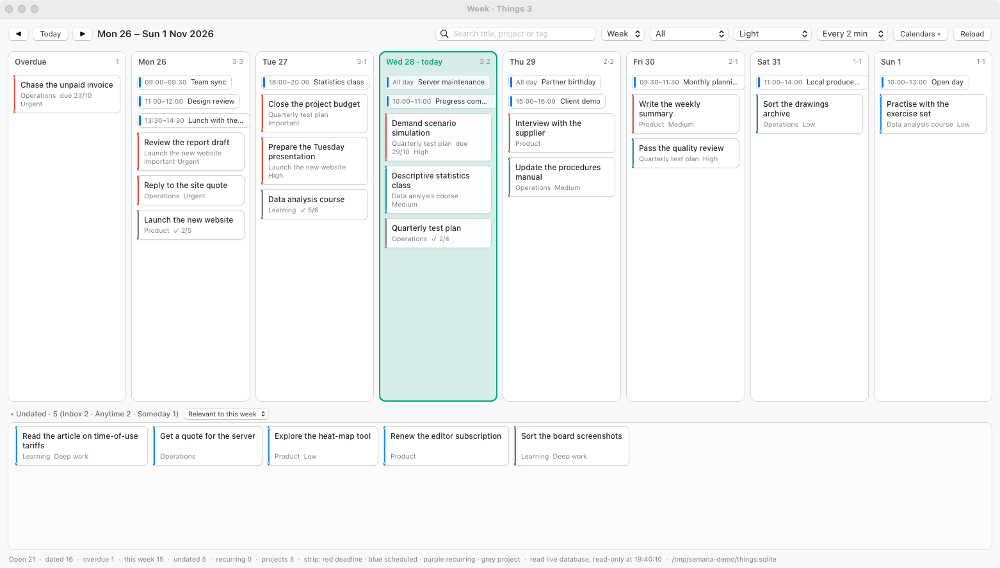
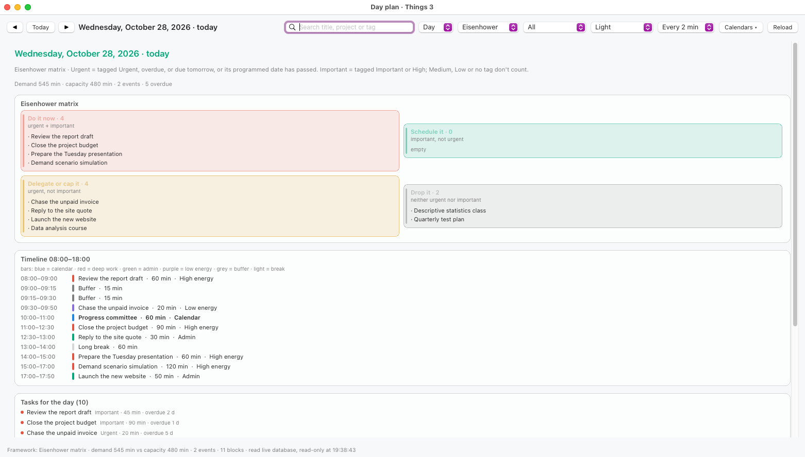

# Semana · Things 3 + Calendar as a weekly board and a day plan

A native macOS app (AppKit, no Storyboard, no Xcode project) with two views in the same
window. *Semana* is Spanish for "week".

- **Week**: a Monday-to-Sunday board with your open Things 3 to-dos, an overdue column,
  calendar events on their day, and a tray of undated to-dos.
- **Day**: a plan for the chosen day, built with the framework you pick
  (Eisenhower, time blocking by energy, Eat the Frog, MoSCoW, 1-3-5 or Pareto Top 3).

Written for a 2017 MacBook Air on macOS 13: Intel binary, no external dependencies,
a single system library (`libsqlite3`) and about 4 MB of RAM at rest. Bilingual
English/Spanish interface (**View ▸ Language**), starting from the system language.

**Read-only.** The app never writes to Things or Calendar: it reads their SQLite databases.
The only action that changes anything, *Complete*, goes through Things' own URL scheme.

| Week view | Day plan (Eisenhower) |
|---|---|
|  |  |

Both screenshots come from **demo mode**, with made-up to-dos and events:

```bash
./build.sh                              # builds build/Semana.app
zsh Tools/demo.sh                       # generates the sample databases and opens the app
zsh Tools/demo.sh --day                 # same, in the day view
```

Demo mode points the app at `build/demo/` through `SEMANA_THINGS_DB` and `SEMANA_CALENDAR_DB`,
so it works without Things 3 installed and without granting any permissions.

## Contents

- [How it reads Things](#how-it-reads-things-and-why)
- [How it reads Apple Calendar](#how-it-reads-apple-calendar)
- [The day plan](#the-day-plan)
- [Build](#build) · [Permissions](#permissions-avoid-re-granting-full-disk-access-on-every-build) · [Usage](#usage)
- [Honest limitations](#honest-limitations) · [Layout](#layout) · [The icon](#the-icon)
- [Five AppKit traps](#five-appkit-traps-that-cost-the-window)

MIT licence.

## How it reads Things (and why)

Things 3 **has no read API**. Its URL scheme (`things:///…`) can create, show and update
items, but not list them. So the app reads the Things SQLite database,
**never writing to it**, through two paths in this order:

1. **Live database in read-only mode** (`SQLITE_OPEN_READONLY`). SQLite serves the read
   via MVCC from the WAL: it doesn't block Things or touch the file. It's the same path
   the Things MCP server uses, and it avoids copying 31 MB on every refresh.
2. **Temporary mirror**, if the above fails: copies `main.sqlite` + `-wal` + `-shm` to
   `$TMPDIR/ThingsWeek.read`, validates it with `PRAGMA quick_check`, and works on the copy
   (opened read-write *only so SQLite can rebuild its WAL index*).
   The copy is deleted afterwards.

The status bar always says which path was used.

Actions: **Open in Things** and **Complete** go through the official URL scheme
(`things:///show` and `things:///update?completed=true`). Nothing in the app modifies your
library directly: Things applies the change.

`update` requires Things' authorization token. Semana reads it from the `TMSettings` table
of the same database, so there's nothing to paste by hand; you only need
*Things → Settings → General → Enable Things URLs* turned on. If it isn't, Complete tells you
instead of failing silently. **Repeating** to-dos can't be completed from outside
(a limitation of the Things URL scheme), so the option is disabled for them.

### The date format (it's not an epoch)

The `startDate`, `deadline` and `rt1_nextInstanceStartDate` integers in Things are neither
seconds nor days since a base date: they are **packed bits**

```
YYYYYYYYYYYMMMMDDDDD0000000        year << 16 | month << 12 | day << 7
```

Any attempt to treat them as an epoch drifts: the step is 128 per day *within* a month
and jumps at month boundaries, so a linear fit accumulates 1, 2 or even 138 days of error
depending on the range. The app decodes them with the masks
`134152192 / 61440 / 3968` (year, month, day), the same scheme `things-py` uses, and the
result was checked against real dates shown by Things.

Reading rules used:

| Field | Meaning |
|---|---|
| `type` | 0 = to-do, 1 = project, 2 = heading (headings aren't listed) |
| `status` | 0 = open (2 cancelled and 3 completed are left out) |
| `trashed` | 1 excludes the row |
| `start` | 0 Inbox · 1 Anytime · 2 Someday |
| `rt1_recurrenceRule IS NOT NULL` | repeating to-do |
| `rt1_nextInstanceStartDate` | next occurrence; for repeating to-dos it wins over `startDate`, which holds the original anchor |
| `rt1_instanceCreationPaused` | 1 = paused; Things doesn't show it, and neither does the app |

**Which day a card lands on:** with both a scheduled date and a deadline, the **earlier**
one wins (the day you planned to work on it); the deadline is shown on the card as
`due 28/10` and as a red stripe. With only one of the two, that one decides.

## How it reads Apple Calendar

The live database is `~/Library/Calendars/Calendar.sqlitedb` (not `Calendar Cache`, nor the
`ZCALENDARITEM` table older prompts mention: that's Core Data from another version). The
tables that matter:

| Table | What for |
|---|---|
| `Calendar` | list of calendars: `ROWID`, `title`, `color`, `store_id` |
| `Store` | the **account** that owns each calendar: iCloud, Google, "Other" (local), "Subscribed Calendars", "Default" |
| `CalendarItem` | the event: `summary`, `start_date`, `end_date`, `all_day`, `hidden`, `status` |
| `OccurrenceCache` | one row per occupied day: `day`, `occurrence_date`, `calendar_id`, `event_id` |

Details that took some digging:

- **`day` and `occurrence_date` are `CFAbsoluteTime`**, not Unix epoch: seconds since 2001,
  so `978307200` must be added to convert them.
- `OccurrenceCache.day` is the day's local midnight, and `occurrence_date` the actual start
  of that occurrence. Repeating events are already expanded there, which is why that table
  is queried rather than `CalendarItem` directly.
- `CalendarItem.end_date - start_date` gives the duration; all-day events have
  `all_day = 1` and no time is drawn.
- `hidden = 1` and `status = 2` (cancelled) are excluded.
- **Calendars off by default**: those whose title contains *Found in Mail*,
  *Found in Natural Language*, *Facebook Birthdays*, *Phases of the Moon*, *Siri* or
  *Birthdays*. They're still offered in **Calendars ▾**, under *Suggestions & system*, in
  case you want them. Calendar's internal placeholders (`DEFAULT_*` and the `Default`
  calendar of Apple's Default store) aren't offered at all, since they never hold your events.
- The selection is saved **by title**, not by `ROWID`: iCloud/Google rowids can be
  reordered between syncs and the title is what stays stable. That's also why the picker
  shows each title once, even when it exists in several accounts.
- The account comes from `Store.name` (a `LEFT JOIN` on `Calendar.store_id`) and is translated
  when the picker is drawn, not when the database is read, so switching language doesn't
  require reloading calendars. Accounts stored under an email address instead of a brand are
  normalised by domain (gmail.com → Google, icloud.com/me.com → iCloud,
  outlook/hotmail/live → Outlook) so full addresses never appear in the interface.

It's read read-only, like Things, and needs Full Disk Access.

## The day plan

`Planner.swift` is a pure engine: it takes the day's to-dos + events and returns a `DayPlan`.
The view only draws. The six frameworks:

| Framework | What it decides | From which signal |
|---|---|---|
| Eisenhower matrix | 4 quadrants | urgency = Urgent tag, overdue or due tomorrow, or a past scheduled date; importance = Important or High tag |
| Time blocking by energy | 08:00–18:00 blocks | estimated size + time of day (deep work before admin) |
| Eat the Frog + 2 min + Parkinson | the frog, quick wins, end time | importance + estimate ≥ 45 min |
| MoSCoW | Must / Should / Could / Won't | the day's free capacity: Must ~55 %, Should ~85 %, Won't is the overflow |
| 1-3-5 | 1 big, 3 medium, 5 small | ≥ 60 / ≥ 25 / < 25 min |
| Pareto · Top 3 | the 3 that move the day | priority order of the active framework |

**Priority ladder.** The *Tasks for the day* list doesn't follow quadrant order: it sorts
by tag, highest first, and within the same rung real urgency decides
(`Urgent` tag, overdue or due tomorrow, or a scheduled date already past), then how
overdue it is, and finally the shortest first:

```
Important › Urgent › High › Medium › Low › untagged
```

Each row repeats in grey the tag that put it there (`Important · 45 min`), so the reasoning
can be read without opening Things; if it has no tag and is urgent only because of its date,
it says so (`30 min · urgent by calendar`). The colour dot on the left follows the same
ladder: red, amber, blue and grey. These are your Things tags as they are, untranslated.

**Colours in the matrix.** The four quadrants are tinted and carry an accent bar, so they
can be told apart without reading: red *Do it now*, green *Schedule it*, amber
*Delegate or cap it*, grey *Drop it*. In dark mode the tint's intensity changes, not its colour.

**Estimated effort** (Things has no duration field): if the title or notes say
"25 min" or "1h30", that's used; otherwise `number of checklist items × 10`; otherwise 90 min
for projects, 45 for the High tag, 15 for Low, 30 by default. It's an estimate, not a fact.

**Capacity**: a 600-minute working day (08:00–18:00) minus what your events already take,
minus 60 min of breaks. The status bar shows demand vs capacity, and the timeline stops
assigning when the day runs out: anything left over shows up as such instead of being
squashed against 18:00.

Calendar events win over to-dos in the timeline: a block never overlaps an appointment,
and the long break is only added if the 13:00 slot is free.

## Build

```bash
git clone https://github.com/RizaMora7/Week-Things-3.git
cd Week-Things-3
./build.sh                      # produces build/Semana.app (ad-hoc signed)
open build/Semana.app
```

Build options:

```bash
SIGN_ID="Semana Dev" ./build.sh                 # sign with a stable identity
INSTALL_DIR=/Applications ./build.sh            # install to a fixed path (no sudo if you're an admin)
OPTIMIZE=1 ./build.sh                           # optimised binary (whole-module -O takes minutes)
```

The build targets Intel (`x86_64-apple-macosx13.0`). On Apple Silicon it runs under Rosetta;
for a native binary, change `TARGET` in `build.sh` to `arm64-apple-macosx13.0`.

## Permissions: avoid re-granting Full Disk Access on every build

The Things database lives in a *Group Container*, and macOS only lets apps read it if they
have that group's entitlement or **Full Disk Access** (FDA). There's no narrower permission
for this path.

FDA is remembered by **bundle ID + signature hash + .app location**. With ad-hoc signing
(`-s -`) the hash changes on every build, which is why the permission gets lost. To make it
stick:

1. **Create your own signing identity** (once):
   Keychain Access → *Keychain Access ▸ Certificate Assistant ▸ Create a Certificate…* →
   Name: `Semana Dev` · Certificate Type: **Code Signing** → Create.
2. **Always build with that identity and to the same path**:
   ```bash
   SIGN_ID="Semana Dev" INSTALL_DIR=/Applications ./build.sh
   ```
3. **Grant FDA once** to `/Applications/Semana.app`:
   System Settings → Privacy & Security → Full Disk Access → `+` → drag the app in →
   quit and reopen the app.

If TCC ever misbehaves after an identity change, reset its record:

```bash
tccutil reset SystemPolicyAllFiles cl.zamorano.semana
```

## Usage

| Shortcut | Action |
|---|---|
| `⌘←` / `⌘→` | previous / next week (Week view) |
| `⌘T` | back to this week / today |
| `⌘R` | reload now |
| click a card or row | open the to-do in Things |
| right-click | open · complete · copy title · copy UUID |

- **`Week / Day` selector** in the top bar. In Day mode the **framework selector** and the
  `◀ Today ▶` stepper also appear to move day by day; the date is remembered.
- **`Calendars ▾`**: a panel that stays open while you tick boxes, grouped by account
  (iCloud, Google, Subscribed…) with each calendar's colour, plus *All*, *Only mine* and
  *None*. Changes are saved immediately and the board reloads a moment after the last one.
- **Language**: **View ▸ Language** → *System / Spanish / English*. Everything switches on
  the fly (bar, menu, board, day plan, context menus and notices) without restarting, and
  it's remembered. `System` follows the macOS language; the names of your Things tags
  (`High`, `Urgent`, …) and projects aren't translated: they're your data.
- **Today highlighted**: in the week view today's column gets a tinted background, a
  coloured border and a `Sun 25 · today` header; in the day plan the title adds `· today` and
  is drawn in the accent colour.
- **Which day each card lands on**: a to-do occupies a single day. If it has both a scheduled
  date and a deadline, the **earlier** date wins, i.e. the day you planned to work on it; the
  deadline is shown in the card's footer as `due 28/10` and in its red stripe. With only one
  of the two, that one decides. The Day view is broader: a to-do appears there as soon as
  either date is reached.
- **Undated tray**: a multi-row grid at the bottom of the window (it uses the height instead
  of a single horizontally scrolling row). The **Scope ▾** pop-up decides what it shows:
  *Relevant to this week* (projects/areas that already have something dated in the visible
  week, plus whatever is in the Inbox), *Inbox and anytime*, or *All undated*.
  It collapses with `▾ Undated`.
- **Auto-refresh**, can be turned off (30 s, 2, 5, 15 min). It compares the database's
  modification date and skips the work if nothing changed, to save battery.
- **Automatic theme** by time of day: dark from 19:00 to 06:59, with a manual override.
- **Search** over title, project, area, tags and notes. The filter also applies to the day
  plan: whatever doesn't match stays out of the matrix and the timeline.
- **Filters**: all, dated only, deadlines only, projects only.
- **`Launch at login`** in the app menu (uses `SMAppService`, macOS 13+).
- View, day, framework, week, filter, search, active calendars, theme, language, tray scope,
  refresh interval, collapsed tray and window size are all remembered.
- The status bar shows what matters in each mode: in Week, totals and which read path was
  used; in Day, the active framework, demand vs capacity, events, number of blocks and the
  time of the last read.

## Honest limitations

- **The theme doesn't always persist**: choosing *Dark* may come back as *Light* on relaunch.
  The language is saved correctly, so the suspect is `applyThemeMode` and how the
  `NSPopUpButton` re-sends its action when an index is selected in code. Not fixed yet.
- **Refresh**: *undated* to-dos don't age on their own in the database. Things computes
  "Today" when it opens; if you don't open Things, a to-do scheduled for yesterday keeps
  showing on its day rather than in Overdue until Things writes again. The app doesn't
  simulate that engine.
- **Repeating to-dos**: the app reads the next occurrence Things has already computed
  (`rt1_nextInstanceStartDate`); it doesn't run its own recurrence engine, so a very old
  repeating to-do with no upcoming instance may not show up. They also can't be completed
  from the app (Things' URL scheme doesn't allow it).
- **Project deadlines**: projects with a deadline show up as marked cards, but Things
  propagates a project's deadline to its to-dos in some cases: you may see the same date on
  two different cards.
- **Complete needs Things**: it's delegated to Things via URL, so Things must be installed
  with *Enable Things URLs* turned on (it doesn't need to be in the foreground).
- **Signing**: without a Developer ID, Gatekeeper requires right-click → Open the first time,
  and TCC remembers the app by its signature.
- **Effort estimates**: the plan's minutes are inferred (title/notes → checklist →
  tags → 30 by default). They're for laying out the day, not for committing to.
- **Eisenhower and your tags**: the matrix only discriminates with `Important`, `High` and
  `Urgent`. If a day is full of `Medium` and `Low`, Q1 and Q3 come out short and *Drop it*
  large: that's the correct reading, not a bug. MoSCoW and 1-3-5 don't depend on tags.
- **Calendar**: what's shown is what `OccurrenceCache` has already expanded. A newly created
  repeating event, or one with a range outside what Calendar cached, may take a while to
  appear; the app doesn't compute recurrences itself.
- **Window width**: it can be dragged freely from the declared 900 pt up to the screen size.
  The eight columns share the visible width; below ~912 pt the board strip gets horizontal
  scrolling. In very narrow windows the bar's pop-ups truncate (`We…`, `Al…`): that's
  AppKit's default when content doesn't fit, and it only shows if you drag the window below
  ~1100 pt.

## Layout

```
Sources/
  ThingsDate.swift      decoding of bit-packed dates
  Strings.swift         bilingual ES/EN table: L.s / L.f / L.n and the Lang type
  SQLiteDB.swift        minimal libsqlite3 wrapper
  ThingsStore.swift     DB discovery, direct read + mirror, queries, URL-scheme actions
  CalendarStore.swift   Calendar.sqlitedb: calendars with their account and events per day
  CalendarPicker.swift  the Calendars ▾ popover: grouped by account, colour dots, bulk actions
  Planner.swift         daily plan engine: the 6 frameworks, priority ladder and blocks
  Models.swift          TaskItem, Board, week helpers and per-language formatting
  Theme.swift           light/dark palette, quadrant tints, preferences
  Views.swift           TaskCard, WeekColumnView, EventRow and the UndatedTrayView grid
  DayPlanView.swift     DayPlan rendering: matrix/MoSCoW/1-3-5/Top 3 + timeline + list
  BoardController.swift window, week/day navigation, filters, refresh, actions
  AppDelegate.swift     menu (including Language), first launch, launch at login
  main.swift            entry point
Tools/demo.sh           builds the demo databases and opens the app on them
Tools/makedemo.sh       generates the made-up Things + Calendar databases in build/demo/
Tools/iconpack.swift    crops an icon from a reference sheet into a master with transparency
Tools/mkiconset.sh      PNG master → AppIcon.iconset → AppIcon.icns (the 10 canonical sizes)
Tools/makeicon.swift    older code-drawn generator (still useful as a base)
Tools/ordercheck.swift  harness: checks the priority ladder and Eisenhower quadrants (ES and EN)
Tools/shot.sh           captures the window to review the interface
build.sh                swiftc + .app bundle + Info.plist + signing
```

## The icon

`Resources/AppIcon.icns` comes from a reference sheet; it isn't drawn in code. The pipeline:

```bash
xcrun swiftc -framework AppKit -o build/iconpack Tools/iconpack.swift
build/iconpack probe  sheet.png 150 520 0 450      # finds the squircle's edge
build/iconpack crop   sheet.png build/master.png 58 165 390 497
zsh Tools/mkiconset.sh build/master.png Resources/AppIcon
```

`crop` applies a corner mask with a 20 % radius, so the master gets real transparency
instead of the sheet's white background (or checkerboard). Two `iconutil` traps: the file
prefix is literally `icon_`, not the app's name, and it only recognises 16/32/128/256/512
with their `@2x`; with any other name it fails with a terse "Failed to generate ICNS".

There are two masters in `Resources/`: `AppIcon.icns` (light mode, used by the bundle) and
`AppIconDark.icns` (dark mode, kept in case it's ever needed).

## Geometry diagnostics

For visual geometry diagnostics: `SEMANA_DEBUG=1 build/Semana.app/Contents/MacOS/Semana`
dumps the frame of the window, each view and the columns to stderr.

## Five AppKit traps that cost the window

Kept here so they don't come back:

1. **The window's minimum is set by its content, not by `window.contentMinSize`.** You can
   set `contentMinSize = 900 × 480` and the window still won't go below what its
   constraints demand. In this app the floor reached 1840 pt from three separate sources: the
   `EventRow` labels (a long event title asked for its full width), the sum of the tray's
   cards (5 × 212 pt) and the bar's six pop-ups.
2. **The minimum-size calculation treats constraints of priority 250 and above as hard.**
   This was the hard one to find: each tray card's 212 pt width was at priority 900 and kept
   inflating the minimum; at 600 the same happened; at 200 the window went from 1148 pt down
   to 912. The rule of thumb: a size *wish* (card width, search field width) goes below 250,
   and above whatever the spacer that should give way hugs at. Labels that may truncate get
   `setContentCompressionResistancePriority(.defaultLow, …)`.
3. **`NSStackView` pins `lastView.trailing == stack.trailing` as a required constraint**,
   so a row inherits its content's width. In the tray each row is now anchored with
   `row <= grid − 2·inset` (not `==`) and ends with a collapsible spacer that absorbs the
   leftover so the cards don't stretch.
4. **`isHidden` does NOT remove a view from Auto Layout.** The collapsed tray kept taking its
   200 pt of height, and the hidden header kept stealing width from the day plan, until their
   `heightAnchor`s were collapsed too (constant 0 in `applyTrayLayout`).
5. **Never resize the window from `windowDidResize`.** It short-circuits layout in the middle
   of a `CATransaction` and ends in `EXC_BAD_INSTRUCTION` via `-[NSApplication
   _crashOnException:]`. Same with macOS state restoration: it revives frames from monitors
   that are no longer connected, so the window uses `isRestorable = false` and validates (and
   deletes) the `NSWindow Frame ThingsWeekMain` key before setting the autosave name.
